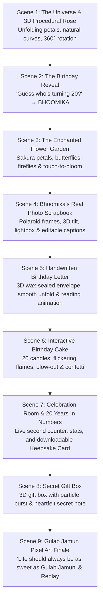

# BLOOM — A Birthday Story for Bhoomika ♡
### *"For a girl who makes life bloom."*

A cinematic, interactive 20th birthday web experience built especially for **Bhoomika** (22 November).

---

## 🌸 Overview

**BLOOM** is an emotionally resonant, interactive digital experience combining:
- **Cinematic dark aesthetics** (midnight burgundy, obsidian black, dusty rose, blush pink, and champagne gold).
- **A genuine 3D Procedural Red Rose** engineered with Three.js botanical geometry (realistic layered petals, curled bud core, reflexed petal rims, green calyx, stem, and leaves) converted into high-resolution character/ASCII art with real-time 360° rotation, wind swaying, and natural bud-to-bloom unfolding.
- **Bhoomika's Real Photo Scrapbook** using her actual photographs (`6.jpeg`, `J5.jpeg`, `J4.jpg`, `J3.jpg`, `J2.jpg`, `J1.jpeg`) with 3D perspective tilt, washi tape accents, handwritten captions, zoom-in/out lightbox, and in-app caption editing.
- **The Enchanted Flower Garden** with animated sakura blossoms, drifting roses, fluttering butterflies, glowing fireflies, and touch-to-bloom interactions.
- **Handwritten Birthday Letter** inside an interactive 3D wax-sealed parchment envelope with smooth unfolding and sentence-by-sentence reading animation.
- **Interactive Birthday Cake** with multi-tier icing, golden ribbons, "20" candles with flickering flames, interactive blow-out detection (tap or microphone breath detection), realistic smoke curls, celebratory confetti, and wish fulfillment.
- **The Celebration Room & 20-Year Milestone Counter** featuring life in numbers (20 trips around the sun, 240 months, 7,305+ days, 175,320+ hours, and live precision seconds), plus a downloadable high-resolution **Personalized Birthday Keepsake Card (PNG)**.
- **Secret Surprise** with an untying 3D gift box revealing a heartfelt hidden reminder.
- **Special Grand Finale — Gulab Jamun Pixel Art Surprise:** A sparkling royal dessert bowl with plump golden-brown Gulab Jamun sweets, glistening amber sugar-syrup, emerald pistachios, saffron strands, and interactive syrup sparkles!
- **Procedural Ambient Music & Audio Synthesizer** powered by the Web Audio API (warm Rhodes/piano chords, wind chimes, sparkle arpeggios, envelope rustle, candle blow noise, and volume/mute controls) requiring zero external audio files.

---

## 🎬 Journey Through The Experience



---

## 📸 Bhoomika's Real Photographs

The memory scrapbook features all six authentic photographs located in [`public/images/memories/`](file:///c:/JAMUN%20C/public/images/memories/):
1. **`6.jpeg`** — Opening memory: *"Every picture holds a little piece of happiness."*
2. **`J5.jpeg`** — Golden moments and peaceful smiles.
3. **`J4.jpg`** — Radiant warmth, laughter, and grace.
4. **`J3.jpg`** — Timeless memories and endless dreams.
5. **`J2.jpg`** — Quiet reflections and gentle times.
6. **`J1.jpeg`** — Chapter 20: *"Some moments become memories. Some memories become treasures."*

---

## 🌹 Procedural 3D Red Rose

- **Morphology:** 5 concentric whorls of curved petals (Layer 0 bud core to Layer 4 broad reflexed outer petals) with realistic thickness, cupping, and reflexing curves.
- **Stem & Foliage:** Naturally curved green stem, 5 calyx sepals, and serrated compound leaves with leaflets.
- **Lighting & Shader:** Multi-point cinematic lighting rendered to a high-resolution character/ASCII matrix preserving the natural rose silhouette, deep velvety crimson shadows, and glowing pink reflexed highlights.
- **Interactive Controls:** 360° auto-rotation toggle, wind swaying, and mouse/touch drag tilt.

---

## 🍯 Gulab Jamun Pixel Art Surprise

- **Visual Design:** Black and deep chocolate background with glowing amber radial light.
- **Dessert Plate:** Royal silver-and-gold filigree dessert bowl filled with translucent amber sugar syrup (*chashni*).
- **The Sweets:** Three spherical Gulab Jamuns with 3D light modeling, golden-brown crusts, deep caramelized mahogany shadows, glossy reflective syrup highlights, and emerald pistachio/saffron garnishes.
- **Interactive:** Tap anywhere on the plate to trigger sugar sparkle ripples and sweet toast feedback!
- **Milestone Poetry:**
  - *"Okay Bhoomika... one last sweet surprise! ♡"*
  - *"Life should always be as sweet as Gulab Jamun."*
  - *"Stay sweet, keep smiling and keep blooming!"*
  - *"Happy 20th Birthday, Bhoomika! ♡"*

---

## 🚀 Quick Start Guide

### 1. Run Development Server
```bash
npm run dev
```
Open `http://localhost:5173` in your browser.

### 2. Build for Production
```bash
npm run build
```

To preview the production build:
```bash
npm run preview
```

---

## 💻 Tech Stack

- **React 19 & TypeScript:** Type-safe, component-driven architecture.
- **Three.js & WebGL:** Procedural 3D botanical rose geometry and lighting.
- **Vite 6 & Tailwind CSS v4:** Ultra-fast bundling, glassmorphism, responsive utilities, and glow effects.
- **HTML5 Canvas:** 3D ASCII Shader, Falling Petals, Garden Butterflies, Fireflies, and Gulab Jamun Pixel Renderer.
- **Canvas-Confetti:** High-performance celebration fireworks and heart showers.
- **Web Audio API:** Zero-dependency procedural ambient music and sound effects engine.
- **Lucide React:** Minimalist luxury iconography.

---

*"Some flowers bloom once. Some make the world bloom around them.*  
*Keep blooming, Bhoomika."*
